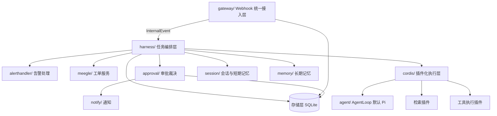
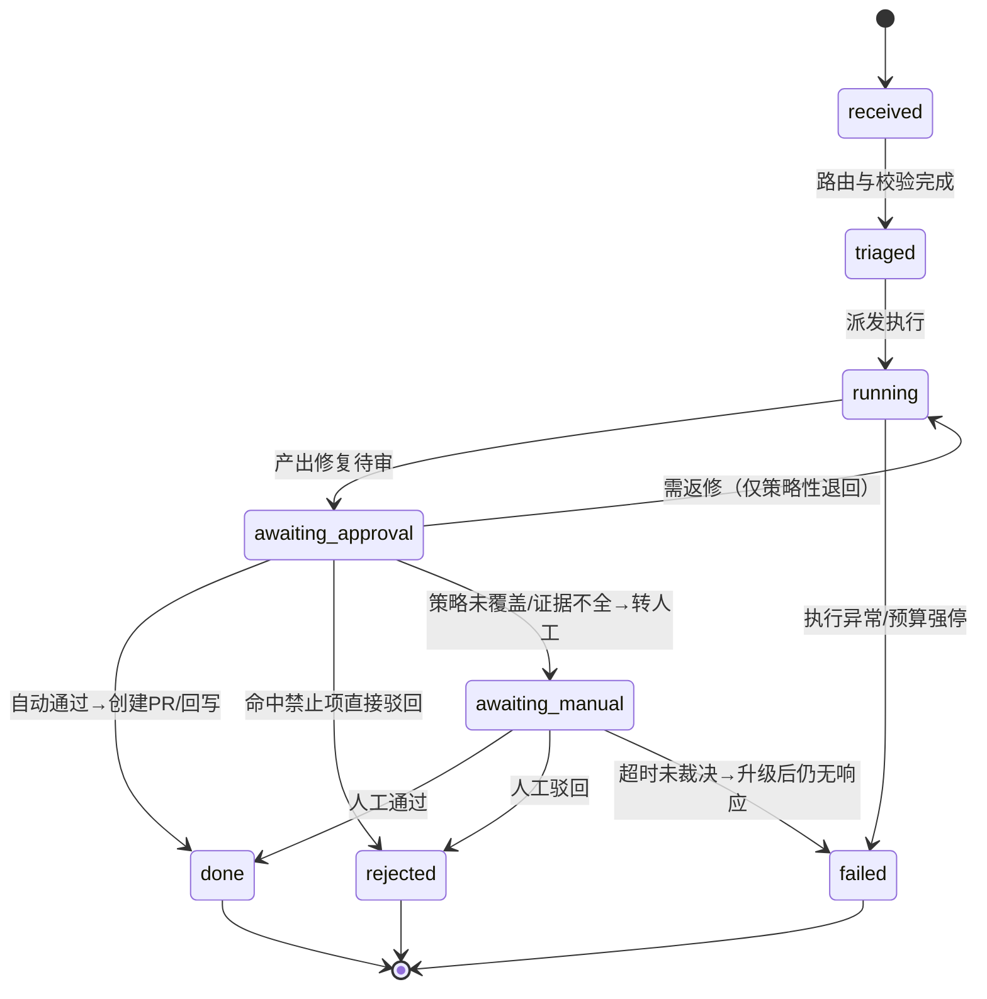

# Vulcan Agent（火哨）开发者规格说明（DEV_SPEC）

> 版本：0.1.0 · 状态：草稿 · 版本核对日期：2026-09-28
> 适用范围：vulcan-agent 后端（`src/server/`），面向企业研发场景的告警处置 Agent 平台
> 事实来源：本仓库源码（`src/`、`config/`、`package.json`）+ 《技术方案 - Vulcan 火哨》（Obsidian：`AI 学习/20-Agent 架构与开发/27-Vulcan 火哨 Agent/`）

## 目录

1. 定位与目标
2. 约束与环境
3. 技术选型
4. 架构
5. 领域模型与数据
6. 目录结构与模块清单
7. 接口与契约
8. 关键流程
9. 配置设计
10. 权限、审计与确定性
11. 可观测性
12. 测试策略
13. 交付计划
14. 任务清单
15. 已知风险与踩坑
16. 后续扩展

---

## 1. 定位与目标

系统定位：面向企业研发场景的告警处置 Agent——复用成熟 Agent 能力（默认 Pi Agent Runtime），补齐企业上下文与交付流程，把监控告警与 meegle 工单自动整理成**可人工审核的修复**。设计核心：确定的流程交给程序，需要探索的步骤交给 Agent，不确定的决策交给人（《技术方案》第一章）。

明确排除项（它不是什么）：

1. 不是通用编码助手 / IDE 插件——不与 Claude Code 类工具竞争通用场景。
2. 不重造 Agent 运行时——Agent 循环复用 Pi，Cordis 只做装配与插件管理，本身不做模型推理。
3. 不做多租户 SaaS——单企业内部部署，按项目配置隔离，不做租户体系。
4. 不做自动合并主干——一切对外写操作（创建 PR、回写工单）经审批裁决，生产级告警默认只出建议。

核心目标：

1. 告警→修复→审批→PR 端到端闭环可运行 —— 成功指标：历史 Bug 对照数据集上，端到端交付成功率较通用 Claude Code 流程相对提升 25%（评测平台、样本规模与口径见《评测方案》配套文档，落地时以此文档实测值为准）。
2. 自动化水位可度量 —— 成功指标：人工介入率（转人工任务占比）可统计并按月对比；自动审批命中禁止项的驳回率 100%（见 §10）。
3. 全链路可追溯 —— 成功指标：任一任务可通过 `trace_id` 在 Langfuse 中还原完整链路（意图→检索→工具→结果→Token 成本）；Webhook 投递日志可回答"某条告警为什么没处理"。

## 2. 约束与环境

运行时要求：Node.js ≥ 22.19.0（`package.json:9` engines），ESM，TypeScript 经 `--experimental-strip-types` 直跑（README「技术栈」节）；开发环境 macOS，生产目标 Linux x64（具体发行版与资源规格：待核（2026-09-28），企业内网部署方案未定）。

环境矩阵：

| 环境 | 用途 | 数据特征 | 部署方式 |
|---|---|---|---|
| dev | 本机开发与单测 | SQLite 文件、loopback、模拟 Webhook 投递 | 本机 `npm run dev` |
| staging | 三条链路联调、评测跑批 | 脱敏后的历史告警/工单样例，评测模式下清空长期记忆（《技术方案》6.5） | 企业内网单实例，配置独立（待核（2026-09-28）：内网主机与反代归属） |
| prod | 真实告警/工单接入 | 真实 payload（含代码片段，注意外发合规，见 §11） | 企业内网单实例 + reverse proxy（网关仅 loopback bind，`config/config.yaml:4`） |

升级与回滚基线：单实例部署，升级=停写→替换进程→重启，Webhook 事件队列持久化保证未处理事件重启后重放；回滚=回退进程版本+回退 DB 迁移（迁移脚本必须配 down）；最长可接受中断时间 10 分钟（超出后告警积压由重试队列兜底）。

## 3. 技术选型

版本原则：不拿 pre-release 当生产基线；lockfile 与目标版本一致，上线构建用 lockfile 固定 transitive 依赖。

| 组件 | 目标版本 | 是否最新稳定 | 判断依据 | 依据出处 |
|---|---|---|---|---|
| 运行时 | Node.js 22 LTS（≥22.19.0） | 否（钉 LTS 线） | engines 已钉 22 线；`--experimental-strip-types` 在 22.x 可用；24 非 LTS 不作生产基线 | `package.json:9` |
| 语言 | TypeScript 5.9.3 | 是 | devDependencies 固定版本 | `package.json:21` |
| 类型检查加速 | tsgo `@typescript/native-preview` 7.0.0-dev.20260120.1 | 否（preview，仅本地工具） | 仅用于 `npm run typecheck` 开发期加速，不参与生产构建与产物；稳定基线仍由 typescript 5.9.3 承担；tsgo 误报以 tsc 为准 | `package.json:20`、`package.json:13` |
| Lint / Format | Biome 2.3.5 | 是 | 单工具替代 eslint+prettier，devDependencies 固定 | `package.json:17` |
| 测试 | vitest 4.1.9 | 是 | devDependencies 固定；ESM/TS 原生支持 | `package.json:22` |
| Web 框架 | 无（node:http 内置） | 是 | gateway 骨架零第三方依赖；HTTP 层只需路由+鉴权+读体，不引框架 | `src/server/gateway/index.ts` |
| Agent 底座 | Pi Agent Runtime（`@earendil-works/pi-*`） | 待核（2026-09-28） | 方案定默认 Pi；具体包名与版本未锁定，接入时登记进本表 | README「技术栈」、`src/server/agent/index.ts` |
| 持久化 | SQLite（驱动：待核（2026-09-28），候选 node:sqlite 内置） | — | 单实例、内网部署，SQLite 足够；PG 仅作后续扩展点（见 §16） | `docs/PLAN-TRACKING.md` §五 |
| 观测 | Langfuse（SDK 版本：待核（2026-09-28）） | — | 方案 9.2 指定；span 按 OpenTelemetry GenAI 语义约定携带 `gen_ai.*` 属性 | 《技术方案》9.2 |
| 通知 | 飞书自建机器人 webhook | — | 方案 8.3 指定卡片消息 | `config/config.yaml:17` |

数据库与迁移：SQLite 单文件（路径进 §9 配置）；迁移工具与 down 脚本格式：待核（2026-09-28）（接入持久化时登记）；破坏性变更必须先出迁移说明再合码。

## 4. 架构



分层职责：

| 层 | 职责 | 禁止事项 |
|---|---|---|
| 接入层（gateway） | 统一入口 `/webhook/:source`：HMAC 签名校验、幂等去重、读体限长、payload 归一化为 InternalEvent、投递日志 | HTTP 层零业务逻辑；不感知具体告警/工单语义 |
| 编排层（harness） | 事件消费、校验、权限、路由、任务状态机管理、预算强停、派发链路 | 不做模型推理；不直接执行工具 |
| 执行层（cordis + agent） | 插件注册/装配/生命周期；AgentLoop 组织 ReAct 循环；检索与工具执行 | Cordis 不做模型推理；主模型不直接操作工作区，工具执行一律经工具插件 |
| 支撑模块（alerthandler/meegle/approval/session/memory/notify） | 各自领域的业务规则（详见 §6 模块卡） | 不越过 harness 直接互相调用 |
| 存储层 | SQLite 持久化与查询、schema 演进 | 不含业务规则 |
| 能力网关（meegle client / 飞书 / 告警回写） | 收敛所有对外部系统的访问，统一鉴权、限流、重试 | 业务模块不得自行直连外部系统 |

依赖方向规则：gateway → harness → {alerthandler, meegle, approval, cordis, session, memory, notify} → 存储层；支撑模块只能被 harness 调用。

跨层调用禁令：支撑模块之间禁止互相 import（approval 需要通知必须经 harness 编排或依赖注入 notify 接口）；agent 不得绕过 cordis 直接访问存储层；gateway 不得直接写任务状态。

## 5. 领域模型与数据

核心实体与关系：

| 实体 | 说明 | 关系 |
|---|---|---|
| InternalEvent | 三来源归一化事件（`src/server/types.ts:14-26`）：id/source/type/occurredAt/ref/payload/raw | 一条事件至多产生一个 VulcanTask |
| VulcanTask | 修复任务（`src/server/types.ts:94-101`）：id/source/ref/status | 一个任务属于一个 source+ref；拥有多条 task_event 与一个 session |
| AlertRecord | 告警：fingerprint/severity/service/labels（`src/server/types.ts:32-40`） | 关联 0..1 个 meegle 工单 |
| MeegleWorkItem | 工单（`src/server/types.ts:51-58`） | 关联 0..n 个 VulcanTask |
| Session | 任务现场：结构化任务状态 + 近期对话原文 + 早期摘要三层（《技术方案》5.2） | 属于一个 VulcanTask |
| ApprovalRecord | 审批裁决记录：输入证据/命中规则/三态结论/裁决人 | 属于一个 VulcanTask；对应 0..1 条 AuditLog |
| MemoryRecord | 长期记忆：content + source/project/code_version/verification_status/expires_at（《技术方案》6.3） | 独立实体，按 project 召回进任务上下文 |
| AuditLog | 审计留痕：谁/何时/对什么/做了什么/结果（《技术方案》8.4） | append-only，不可修改 |

状态机——VulcanTask（状态枚举对齐 `src/server/types.ts:84-92`）：



流转由 harness 的确定性流转表实现（见 §10），非法流转一律拒绝并告警。

存储选型与迁移：SQLite 默认（理由见 §3）；核心表 `webhook_events`（幂等去重键=事件 ID 唯一索引）、`tasks`、`task_events`（append-only，含 `parent_event_id` 支持分支回放，沿用 fiat_agent 已验证的 event store 设计）、`sessions`、`approvals`、`memories`、`audit_logs`（append-only，触发器禁 UPDATE/DELETE）。迁移工具：待核（2026-09-28）。

数据保留与合规：短期记忆随任务结束归档为过程记录，不自动成为后续任务上下文（《技术方案》5.2）；长期记忆准入与失效见 §6 memory 模块卡；webhook 原始 payload 快照与归档保留期：待核（2026-09-28）（涉及代码内容外发合规，与 Langfuse 留存策略一并定）；审计记录永久保留、不可修改；密钥/凭证/令牌不入任何表（《技术方案》6.3 排除清单）。

## 6. 目录结构与模块清单

```
vulcan-agent/
├── config/config.yaml          # 非敏感运行配置（密钥只走环境变量）
├── docs/                       # DEV_SPEC、PLAN-TRACKING
├── src/server/
│   ├── cli/entry.ts            # 入口：装配 config→gateway→harness，优雅退出
│   ├── config/                 # 配置加载（YAML + env 覆盖，fail-fast）
│   ├── types.ts                # 全局领域类型与契约
│   ├── gateway/                # 接入层：server / verify / dedupe / normalize / queue
│   ├── harness/                # 编排层：消费循环 / 路由 / 任务状态机 / 权限
│   ├── approval/               # 审批：策略引擎 / 三态裁决 / 人工上下文包 / 审计
│   ├── alerthandler/           # 告警：去重降噪 / 分级 / 关联工单 / 回写
│   ├── meegle/                 # 工单：Open API client（幂等/限流）/ 对账兜底
│   ├── cordis/                 # 执行层：插件契约 / registry / 生命周期
│   ├── agent/                  # AgentLoop（默认 Pi）/ 工具白名单 / 预算强停
│   ├── session/                # 会话：三层短期记忆 / 摘要触发 / 中断恢复
│   ├── memory/                 # 长期记忆：写入门禁 / 召回 / 失效
│   └── notify/                 # 通知：飞书卡片 / 责任人路由 / 超时升级
├── web/                        # React 前端（当前不做，见 §16）
└── test/                       # vitest
```

核心模块：接入层（gateway）/ 编排层（harness）/ 领域层（alerthandler、meegle、approval、session、memory 的业务规则）/ 存储层 / 能力网关（meegle client、飞书、告警回写）/ 配置与可观测（config、日志、指标、trace）。

可选模块启用情况：

| 模块 | 启用 | 理由 / 启用条件 |
|---|---|---|
| 模型 / LLM 接入 | 是 | Agent 循环与任务整理均依赖模型；默认 Pi 驱动，主模型可配 |
| 检索增强（RAG） | 是 | 代码检索与长期记忆召回都走检索；大仓库走远端索引三层形态 |
| 外部工具协议（MCP 类） | 否 | Vulcan 是 MCP 消费方而非提供方：检索能力经检索插件接口接入 MODULAR-RAG-MCP-SERVER，不对上层暴露 MCP 服务 |
| 多租户与数据隔离 | 否 | 单企业内部部署，按 project 字段隔离记忆与权限，不做租户体系 |
| 审批流 | 是 | 创建 PR、回写工单是必须人工确认的写操作；审批是平台核心链路 |
| 异步与事件 | 是 | Webhook 耗时任务必须异步队列 + 重试 + 死信 |
| 定时与批处理 | 是 | meegle 对账兜底、索引新鲜度检查、长期记忆 stale 复核、离线记忆提炼 |
| 第三方抽象层 | 是 | 告警源（Alertmanager/云监控/自建）、meegle、飞书均收敛到统一接口，可替换 |
| 插件 / 扩展机制（Cordis） | 是 | 按项目替换检索/执行能力是平台核心卖点；插件化来自 DSH 思想 |
| 灰度与降级 | 否 | 单实例内网部署，发布直接回退进程；"自动处理开关"已由告警自动修复白名单承担，不另建灰度体系 |

#### 模型 / LLM 接入（agent/）

- 启用条件：任何需要模型推理的环节（任务整理、定位、修复、审批意图判断）。
- 职责：以 Pi 为 AgentLoop，组织 ReAct 循环——模型提出动作→调用工具→结果回喂→再请求模型；执行步数/Token/成本预算强停。
- 输入 / 输出：输入=任务目标与约束（来自 session 三层记忆+检索上下文）；输出=工具调用序列与最终产出（补丁引用、验证证据）。
- 依赖（前置模块）：cordis（工具注册）、session（上下文）、memory（召回注入）、检索插件；外部系统=主模型 API。
- 失败路径与降级：外部不可用（模型 API 超时/限流）→ 按 §7 重试策略重试，连续失败任务转 `failed` 并通知；自身异常（循环超预算/工具打转）→ 强停转 `failed`，trace 留全量现场供归因。
- 验收标准：注入一次模拟的模型 5xx，任务在重试耗尽后转 `failed`，Langfuse 中可回放全部 span。
- 不启用时的行为：无此模块平台退化为纯 Webhook 转工单的规则引擎；当前架构下 AgentLoop 是修复链路必需，不允许关闭。

#### 检索增强（RAG，cordis 检索插件 + memory/）

- 启用条件：任务定位需要代码上下文；长期记忆需要按相关性召回。
- 职责：普通项目本地/服务端索引检索；300GB+ GVFS 大仓库走"远端共享索引+本地增量覆盖+按需读取"三层形态；本地覆盖以内容哈希为准，按需下载后必须核验版本（《技术方案》4.2 四项接口要求：权限在召回前过滤、结果携带 repo/branch/file_path/commit/content_hash、哈希对齐、版本核验告警）。
- 输入 / 输出：输入=查询（自然语言/标识符）+权限范围；输出=带版本坐标的代码片段，超预算按条数与总长度截断。
- 依赖（前置模块）：cordis 插件契约；外部系统=远端索引服务（大仓库形态）、MODULAR-RAG-MCP-SERVER（记忆召回）。
- 失败路径与降级：外部不可用（索引服务不可达）→ 任务挂起在 `running` 并重试，超过阈值转人工；版本核验不一致→显式告警交 Agent 决策，禁止静默替换（《技术方案》4.2 第 4 条）。
- 验收标准：模拟索引返回过期 commit，编辑前核验触发告警且不静默使用；本地修改文件以 content_hash 判定覆盖关系正确。
- 不启用时的行为：关闭后修复链路无代码上下文来源，任务只允许走"仅分析建议"模式；不静默退化为本地全仓扫描。

#### 审批流（approval/）

- 启用条件：存在需人工确认的写操作（创建 PR、回写 meegle、生产配置变更）。
- 职责：五输入裁决（变更意图/内容/验证证据/策略规则/历史同类审批）→ 三态输出 approved/rejected/manual；人工上下文包组装；结论与依据写审计。
- 输入 / 输出：输入=ApprovalRequest（`src/server/types.ts:65-80`）；输出=三态之一+理由，转人工时产出上下文包交 notify。
- 依赖（前置模块）：harness（状态流转）、memory（历史同类审批召回）、notify（转人工通知）；外部系统=企业审批/OA 系统回调。
- 失败路径与降级：外部不可用（审批系统回调丢失）→ 超时升级阶梯兜底（责任人→团队负责人）；自身异常（策略引擎抛错）→ 按从严原则转人工，不放行。
- 验收标准：构造命中禁止项（生产配置/超大 diff/无验证证据）的请求，断言 100% 驳回且不产生转人工通知；构造全条件满足的请求，断言自动通过并触发 PR 创建。
- 不启用时的行为：所有写操作一律转人工裁决，平台退化为"只出建议不执行"。

#### 异步与事件（gateway queue + harness 消费循环）

- 启用条件：Webhook 耗时任务必须与 HTTP 响应解耦。
- 职责：快速响应 2xx 后事件入持久化队列；消费失败重试，超过阈值进死信并告警。
- 输入 / 输出：输入=归一化 InternalEvent；输出=按序投递给 harness。
- 依赖（前置模块）：gateway（生产者）、存储层（队列持久化）。
- 失败路径与降级：外部不可用（下游 handler 持续失败）→ 重试 N 次后死信+飞书告警，事件不丢；自身异常（进程崩溃）→ 重启后从持久化队列重放，幂等键保证不重复执行。
- 验收标准：kill -9 消费进程后重启，断言队列中事件全部被处理且无重复副作用（幂等键命中数=1）。
- 不启用时的行为：退化为同步处理，Webhook 响应时间被拉长、无重试保障；当前架构不允许关闭。

#### 定时与批处理（scheduler）

- 启用条件：存在周期任务（见职责）。
- 职责：meegle 对账兜底（webhook 丢事件时按时间窗拉取补偿）、索引新鲜度检查（索引 commit 滞后告警）、长期记忆 stale 复核、任务定稿后的离线记忆提炼。
- 输入 / 输出：输入=周期触发器；输出=补偿事件/告警/记忆写入候选。
- 依赖（前置模块）：存储层、meegle client、memory 写入门禁。
- 失败路径与降级：外部不可用（meegle API 限流）→ 退避重试，跳过本轮并在下轮补齐（对账按时间窗幂等）；自身异常（提炼器崩溃）→ 本轮跳过，任务归档保留待下轮，不影响在线链路。
- 验收标准：删除一条已投递的 webhook 事件模拟丢事件，对账任务在下轮将其补齐且不产生重复任务。
- 不启用时的行为：对账兜底与记忆提炼停摆，webhook 单通道依赖、长期记忆停止更新；其余在线链路不受影响。

#### 第三方抽象层（能力网关：meegle client / 飞书 / 告警回写）

- 启用条件：外部系统多于一个且可能替换。
- 职责：meegle Open API（`X-PLUGIN-TOKEN`/`X-USER-KEY` 鉴权、`X-IDEM-UUID` 幂等、单 token 单接口 15 QPS 限流，`src/server/meegle/index.ts:5-7`）、飞书机器人、告警系统回写，统一收敛为接口 + 适配器。
- 输入 / 输出：输入=领域层请求；输出=外部响应或结构化错误。
- 依赖（前置模块）：config（密钥注入）。
- 失败路径与降级：外部不可用（meegle 5xx/限流）→ 指数退避重试，持续失败上抛由调用方决定转人工；自身异常（适配器解析失败）→ 保留 raw payload 进死信供排查。
- 验收标准：mock meegle 返回 429，断言限流器按 15 QPS 退避且写接口全部携带幂等 UUID。
- 不启用时的行为：对应链路（工单详情回查/回写、通知）不可用并显式告警，不静默丢消息。

#### 插件 / 扩展机制（cordis/）

- 启用条件：需在不改动本体的前提下按项目替换检索与执行能力。
- 职责：VulcanPlugin/ToolPlugin/RetrievalPlugin 契约、注册表、setup/dispose 生命周期、依赖注入装配。
- 输入 / 输出：输入=插件实现；输出=装配完成的执行层实例。
- 依赖（前置模块）：config（按项目选择插件）。
- 失败路径与降级：外部不可用（插件 setup 抛错）→ 启动 fail-fast，拒绝带病启动；自身异常（运行期插件崩溃）→ AgentLoop 捕获记为工具失败，走任务失败/重试路径。
- 验收标准：注册一个 mock 检索插件替换默认实现，任务全链路无感知完成，dispose 被调用一次。
- 不启用时的行为：Cordis 是装配中枢，不可关闭；关闭等价于平台无执行层。

## 7. 接口与契约

对外接口清单：

| 接口 | 方法 | 入参 | 出参 | 幂等 | 兼容性承诺 |
|---|---|---|---|---|---|
| `/webhook/alert` | POST | HMAC 签名头 + 告警 payload | 2xx `{received:true}`；校验失败 401/403 | 事件唯一 ID 去重，重复投递返回 2xx | payload 字段映射表待核（2026-09-28）：告警源清单未定，定稿前 schema 变更不承诺兼容 |
| `/webhook/meegle` | POST | HMAC 签名头 + meegle 事件 payload | 同上 | `header.uuid` 去重（`src/server/types.ts:45-49`） | 事件类型清单与完整字段待与企版 meegle 管理员确认（`src/server/meegle/index.ts` 注释） |
| `/webhook/approval` | POST | HMAC 签名头 + 审批回调 payload | 同上 | 审批单号去重 | 审批系统清单与字段待核（2026-09-28） |

内部契约（模块间）：

| 契约 | 定义处 | 说明 |
|---|---|---|
| InternalEvent | `src/server/types.ts:14-26` | 三来源归一化事件，下游只面向此模型编程 |
| ApprovalRequest / ApprovalDecision | `src/server/types.ts:62-80` | 审批输入与三态输出 |
| TaskStatus 流转表 | harness 实现，枚举见 `src/server/types.ts:84-92` | 确定性流转，见 §10 |
| VulcanPlugin / ToolPlugin / RetrievalPlugin | cordis 待实现 | 插件契约，setup/dispose 生命周期 |
| 检索接口四项要求 | 《技术方案》4.2 | 权限前置过滤、版本坐标、哈希对齐、下载后核验 |

错误模型：结构化错误三类——`ValidationError`（入参/签名不合法，4xx，不重试）、`TransientError`（外部超时/限流/5xx，可重试）、`PermanentError`（策略驳回/业务规则拒绝，不重试、需人工介入）。错误码规则 `VULCAN_<模块>_<序号>`，客户端（Webhook 调用方）处理：4xx 不重试、5xx 指数退避重试。

并发与一致性：单实例单消费循环，无跨实例锁；事件处理以幂等键（事件 ID）保证 at-least-once 投递下不重复执行；任务状态流转用 SQLite 事务 + 状态前置条件校验（`UPDATE ... WHERE status = <期望前态>`），冲突即非法流转拒绝；最终一致边界——告警关联工单、记忆 stale 标记允许秒级延迟。

## 8. 关键流程

#### 8.1 主链路：告警 → 修复 → 审批 → PR

1. 接入层：`/webhook/alert` 收到告警 → HMAC 校验（失败 403 并记投递日志）→ 幂等去重（重复直接 2xx）→ 归一化 InternalEvent → 入持久化队列 → 返回 2xx。
2. 编排层：harness 消费事件 → alerthandler 去重降噪/分级/匹配责任团队与仓库 → 关联已有 meegle 工单，无则自动建单 → 建 VulcanTask（received→triaged）→ 检查自动修复白名单：不在白名单只产出分析建议并回写告警系统（流程结束）；在白名单则派发执行（triaged→running）。
3. 执行层：AgentLoop 按 session 三层记忆 + 检索上下文执行 复现→定位→修改→测试（reproducing/locating/patching/testing）→ 产出补丁引用与验证证据 → 转 awaiting_approval；步数/Token/成本超预算 → 强停转 failed。
4. 审批：approval 五输入裁决 → 自动通过 → 受控创建 PR、回写 meegle、结论回写告警系统（awaiting_approval→done）；命中禁止项 → 直接驳回并给理由（→rejected）；其余 → 转人工（→awaiting_manual），notify 按责任人路由发飞书卡片。
5. 异常路径汇总：任一步骤外部调用失败按 §7 错误模型重试，耗尽转 failed 并通知；失败任务进入 §9.3 失败归因。

#### 8.2 异步链路：meegle 工单事件

1. 触发条件：meegle 自动化规则 Webhook POST 新单/状态流转/字段变更。
2. 投递保证：at-least-once——meegle 侧重试 + 本地持久化队列重放；重复事件由幂等键（`header.uuid`）去重。
3. 幂等处理：同 ID 事件直接 2xx；事件处理按 ref（工单号）合并最新状态，避免乱序（旧状态覆盖新状态：以 `updated_at` 单调性校验，旧事件丢弃）。
4. 详情补齐：Webhook payload 只带概要，工单详情/评论/附件/关联单经 meegle Open API 按需回查（15 QPS 限流内）。
5. 兜底：定时对账任务按时间窗拉取补偿丢事件（见 §6 scheduler 模块卡）。

#### 8.3 失败恢复链路：任务中断恢复

1. 失败如何被发现：进程重启后扫描持久化队列与 `running`/`awaiting_approval` 状态的在途任务；等待外部事件（测试流水线/人工审批/上游回复）超时由定时任务标记。
2. 重试策略：按固定顺序重建现场（《技术方案》5.3）——读结构化任务状态 → 读早期摘要 → 读近期对话原文 → 重放最近 3 条工具调用结果（不重新执行）→ 重新校验 `base_commit`；校验不通过重新对齐分支再继续。重试耗尽（默认 3 次，进 §9 配置）→ 任务转 failed。
3. 人工介入切入点：任务转 failed 或 awaiting_manual 时 notify 通知责任人；审计记录（§10）与 trace 回放（§11）用于定位"问题出在模型、Prompt、工具还是编排"。

#### 8.4 转人工审批链路

1. 触发条件：策略未覆盖/证据不全/置信度低/风险等级高/历史同类审批曾被驳回（《技术方案》8.3）。
2. 责任人路由：工单 owner → 代码 owner（按文件/blame）→ 值班/团队负责人逐级兜底，抄送申请人。
3. 通知：飞书卡片 @ 责任人 + 人工上下文包（变更意图/关键 diff/影响范围/验证证据/关联工单告警/建议处置与理由）；未处理超时逐级升级。
4. 结果回流：人工在审批系统裁决 → Webhook 回调 Vulcan（走 `/webhook/approval`，复用 §8.1 步骤 4）→ 结论与依据写审计 → 任务从 awaiting_manual 继续，不重开任务。

## 9. 配置设计

| 配置项 | 来源 | 默认值 | 必填 | 校验时机 | 敏感 |
|---|---|---|---|---|---|
| `gateway.host` | config.yaml | 127.0.0.1 | 是 | 启动时 fail-fast | 否 |
| `gateway.port` | config.yaml | 7620 | 是 | 启动时 fail-fast | 否 |
| `gateway.maxBodyBytes` | config.yaml | 1048576 | 是 | 启动时 fail-fast | 否 |
| `meegle.baseUrl` | config.yaml | —（现值待与企版确认） | 是 | 启动时 fail-fast | 否 |
| `VULCAN_WEBHOOK_SECRET_{ALERT\|MEEGLE\|APPROVAL}` | 环境变量 | 无 | 是 | 启动时 fail-fast | 是 |
| `VULCAN_MEEGLE_PLUGIN_TOKEN` / `VULCAN_MEEGLE_USER_KEY` | 环境变量 | 无 | 是（启用工单链路时） | 启动时 fail-fast | 是 |
| `VULCAN_LARK_WEBHOOK` | 环境变量 | 无 | 否（缺失禁用通知并在日志 WARN） | 启动时 fail-fast | 是 |
| `db.path` | config.yaml | `data/vulcan.db` | 是 | 启动时 fail-fast | 否 |
| `agent.maxSteps` / `agent.tokenBudget` / `agent.costUsdBudget` | config.yaml | 50 / 按《技术方案》5.2 表 / 待核（2026-09-28） | 是 | 启动时 fail-fast | 否 |
| `session.summaryEverySteps` / `session.summaryAtBudgetPct` | config.yaml | 15 / 60 | 是 | 启动时 fail-fast | 否 |
| `approval.autoPolicy.<project>` | config.yaml | 从严：未配置即全部转人工 | 否 | 首次裁决时校验 | 否 |
| `alert.autofixAllowlist` | config.yaml | 空（默认只出建议） | 否 | 启动时 fail-fast | 否 |
| `retry.maxAttempts` | config.yaml | 3 | 是 | 启动时 fail-fast | 否 |

fail-fast：上表标必填且敏感的密钥缺失、`gateway.host` 非 loopback（硬约束：`config/config.yaml:4`）、`db.path` 不可写——任一命中拒绝启动。

敏感项处理：密钥只走环境变量，禁止写入 config.yaml、禁止落日志（gateway 投递日志对 header 脱敏）；query string 传 token 一律拒绝（`docs/PLAN-TRACKING.md` 硬约束 2）。

## 10. 权限、审计与确定性

角色与最小权限：

| 角色 | 可执行的操作 | 明确不可执行 |
|---|---|---|
| 系统（自动裁决） | 规则内自动通过审批、创建 PR（仅白名单项目+策略全满足）、回写工单/告警 | 命中禁止项后放行；直接合并主干；修改审批策略自身 |
| 人工审批人 | 在审批系统裁决（通过/驳回），通过 Webhook 回流 | 绕过审批系统直接改任务状态 |
| 平台管理员 | 修改策略阈值、白名单、配置 | 修改/删除审计记录 |
| Agent（AgentLoop） | 在工具白名单与 allowed repos 范围内读/改/测 | 修改接口签名（未获 allow_api_change 时）；触碰 forbidden 清单；直接操作工作区外资源 |

必须由确定性代码实现的判断（不由"模型+提示词"兜住）：

1. 权限判断——检索权限前置过滤（《技术方案》4.2 第 1 条）、allowed repos/forbidden 文件校验；
2. 审批状态流转——三态裁决中策略规则与禁止项命中判定、VulcanTask 状态机流转表；
3. 字段校验——Webhook 签名与入参校验；
4. 任务提交——幂等去重、队列投递；
5. 审计写入——append-only，先写后响应；
6. 预算强停——步数/Token/成本阈值触发终止。

（金额与计费计算不适用：平台无计费场景。）

审批边界：创建 PR、回写 meegle、告警结论回写、任何生产配置变更，一律走 提交 → 审批 → 执行 → 审计，不允许绕过审批直接写。禁止项（生产配置、数据迁移、跨仓、超大 diff、无验证证据）命中直接驳回，不降级为人工（《技术方案》8.2；`docs/PLAN-TRACKING.md` 硬约束 3）。

审计字段：审批单号、裁决人（system/<具体人>）、裁决时间、输入证据快照（diff/测试结果）、命中的策略规则、驳回或转人工理由；审计记录不可修改，用于复盘"为什么这条自动放行了"（《技术方案》8.4）。

## 11. 可观测性

日志字段：`trace_id` / `task_id` / `source` / `event_id` / `module` / `level` / `ts` / `msg` + 上下文字段（错误码、重试次数、耗时）；级别约定——ERROR（任务失败/死信/审计写失败）、WARN（降级/重试/通知渠道缺失）、INFO（状态流转/审批裁决）、DEBUG（工具调用明细）。密钥与凭证禁止落日志。

关键指标（《技术方案》9.1）：

| 指标 | 用途 | 告警阈值 |
|---|---|---|
| 任务成功率（端到端 deliver） | 核心结果指标 | 周环比下降 >10% 告警 |
| 平均步数 | 定位/修改效率，异常抬升=检索或工具打转 | 超预算任务占比 >20% 告警 |
| 每任务 Token 成本 / 美元成本 | 成本与本地模型替换评估 | 单任务超 `agent.costUsdBudget` 强停 |
| 工具调用失败率（按工具拆） | 失败集中的工具是流程卡点 | 单工具失败率 >30% 告警 |
| 人工介入率 | 自动化水位 | 只看趋势，不设阈值 |
| 超预算被强停比例 | 任务拆解/模型行为问题 | >10% 告警 |
| 检索 P50/P95 延迟、每请求成本、引用覆盖率 | 检索质量与上下文组装 | P95 按仓库 SLA 定（待核（2026-09-28）） |
| 单次检索按需下载量（GVFS 场景） | 唯一能证明"没做全仓扫描"的指标 | 超过基线 2 倍告警 |
| 索引新鲜度（索引 commit 滞后时长） | 防止依据过期代码改代码 | 滞后 >1 小时告警 |
| Webhook 死信堆积数 | 事件丢失前兆 | >0 告警 |

链路追踪：每任务生成统一 `trace_id`，Langfuse 串联全链路（用户输入→意图分类→Agent→状态变化→检索内容→工具调用与参数→最终产出→Token→耗时→降级）；模型调用 span 按 OpenTelemetry GenAI 语义约定携带 `gen_ai.*` 属性（《技术方案》9.2）；支持从失败节点回放。

告警与降级：P1（死信堆积/审批回调丢失/审计写失败）→ 飞书即时告警 + 对应链路自动暂停新任务（已存在任务继续）；P2（重试耗尽/索引滞后/成本超限）→ 飞书告警不暂停；评测与可观测的失败归因分类（路由错误/槽位丢失/错误工具/RAG 无命中/无效循环/上下文污染/过早结束/权限越界/模型异常）基于 trace 自动归类（《技术方案》9.3）。

## 12. 测试策略

| 层级 | 范围 | 断言示例 | 目标覆盖 |
|---|---|---|---|
| 单元 | 状态机流转表、审批策略引擎、归一化、去重、HMAC 校验、预算强停 | 非法流转 `running→received` 被拒绝；命中禁止项 100% 驳回且无转人工通知；同 uuid 事件只处理一次 | ≥90%（确定性判断代码要求 100% 分支） |
| 集成 | 三条 Webhook 链路（模拟投递）、SQLite 队列重放、meegle client 限流/幂等（mock 429）、session 中断恢复顺序 | kill -9 后重启无重复副作用；15 QPS 退避；恢复按 5.3 五步顺序执行 | ≥80% |
| 端到端 | 历史 Bug 对照数据集跑批（评测模式清空长期记忆并校验基线） | 端到端交付成功率、人工介入率、失败归因分布可产出对照报告 | 每版本跑一轮 |

覆盖率目标与 CI 门禁：`vitest --run` 全绿 + `tsgo --noEmit` 通过为合码前置（当前 `package.json` scripts 已具备）。

## 13. 交付计划

| 阶段 | 范围 | 依赖 | 验收 |
|---|---|---|---|
| P1 基座 | 配置加载 fail-fast、gateway（HMAC/幂等/归一化/队列/死信）、存储层建表与迁移、harness 消费循环与状态机 | 无 | 三来源模拟 Webhook 全部入库；kill -9 重启无丢失无重复 |
| P2 链路 | alerthandler、meegle client、approval 策略引擎与三态裁决、notify 通知与升级 | P1 | 告警→建单→分析建议回写闭环可演示；禁止项用例 100% 驳回 |
| P3 Agent | cordis 插件契约与装配、Pi AgentLoop 接入、session 三层记忆与中断恢复、检索插件（普通项目形态） | P2 | 一条真实样例工单端到端产出补丁与验证证据，人工通过后创建 PR |
| P4 记忆与观测 | memory 写入门禁/召回/失效、离线提炼、Langfuse trace、指标看板、失败归因 | P3 | trace 可回放任一任务；未验证猜测被门禁拦截的用例通过 |
| P5 大仓与评测 | GVFS 三层检索形态、评测跑批与对照报告 | P4（大仓形态依赖企业索引服务就绪：待核（2026-09-28）） | 下载量指标与索引新鲜度指标上线；对照数据集报告产出 |

里程碑：

| 里程碑 | 时间 | 验收标准 |
|---|---|---|
| M1 基座可用 | 待核（2026-09-28）：单人开发节奏未排期 | P1 验收通过 |
| M2 规则链路闭环 | 同上 | P2 验收通过 |
| M3 Agent 端到端 | 同上 | P3 验收通过 |
| M4 可度量 | 同上 | P4 验收通过 |

## 14. 任务清单

#### 阶段 1：基座（P1）

- [x] P1-1：config 加载（YAML + env 覆盖 + fail-fast 校验）
  - 前置：无
  - 验收：缺任一必填密钥或 host 非 loopback 时启动即退出并打印缺失项；正常配置下 config 对象被各模块读取
- [x] P1-2：存储层建表与迁移脚本（webhook_events / tasks / task_events / sessions / approvals / memories / audit_logs，含 append-only 触发器）
  - 前置：P1-1
  - 验收：迁移 up/down 可重复执行；对 audit_logs 执行 UPDATE/DELETE 被数据库拒绝
- [x] P1-3：gateway HTTP server（路由 /webhook/:source、读体限长、仅 loopback bind）
  - 前置：P1-1
  - 验收：超 maxBodyBytes 请求返回 413；非 loopback 绑定尝试启动失败
- [x] P1-4：HMAC 签名校验（密钥按 source 隔离）
  - 前置：P1-3
  - 验收：正确签名 2xx、错误签名 403、query string 传 token 被拒绝
- [x] P1-5：幂等去重 + 归一化（三来源 payload → InternalEvent）
  - 前置：P1-4
  - 验收：同 ID 重复投递仅入库一次且两次均返回 2xx；三来源样例 payload 归一化后字段断言通过
- [x] P1-6：持久化队列 + 重试 + 死信
  - 前置：P1-2、P1-5
  - 验收：消费抛错 3 次后进死信并触发 P1 告警；进程重启后队列重放无重复副作用
- [x] P1-7：harness 消费循环 + 路由 + 任务状态机（确定性流转表）
  - 前置：P1-6
  - 验收：非法流转被拒绝并告警；alert/meegle/approval 事件路由到正确 handler
- [x] P1-8：cli 入口装配与优雅退出（SIGINT/SIGTERM）
  - 前置：P1-3、P1-7
  - 验收：SIGTERM 后在途事件处理完毕才退出，队列无残留处理中状态

#### 阶段 2：规则链路（P2）

- [x] P2-1：alerthandler（去重降噪/分级/责任团队与仓库匹配）
  - 前置：P1-7
  - 验收：同 group 告警合并；分级与匹配结果断言通过
- [x] P2-2：告警关联/自动建 meegle 工单 + 自动修复白名单
  - 前置：P2-1
  - 验收：无对应工单时自动建单；白名单外告警只产出分析建议并回写告警系统
- [x] P2-3：meegle Open API client（鉴权/X-IDEM-UUID 幂等/15 QPS 限流）
  - 前置：P1-1
  - 验收：mock 429 触发退避；写接口全部携带幂等 UUID；限流内不丢请求
- [x] P2-4：meegle 对账兜底定时任务
  - 前置：P2-3、P1-6
  - 验收：删除一条已投递事件后对账在下轮补齐且无重复任务
- [x] P2-5：approval 策略引擎（allow 规则 + deny 禁止项）+ 三态裁决
  - 前置：P1-7
  - 验收：命中禁止项 100% 直接驳回；全条件满足自动通过；策略引擎抛错时按从严转人工
- [x] P2-6：审计写入（裁决记录 append-only）
  - 前置：P1-2、P2-5
  - 验收：每次裁决产生完整审计字段记录；尝试修改被数据库拒绝
- [ ] P2-7：notify 飞书卡片 + 责任人路由 + 超时升级
  - 前置：P2-5
  - 验收：转人工触发卡片推送含完整上下文包；模拟超时后逐级升级到团队负责人
- [x] P2-8：审批回调回流（/webhook/approval → 任务续跑）
  - 前置：P1-5、P2-5
  - 验收：人工通过后任务从 awaiting_manual 继续而非重开；结论写入审计

#### 阶段 3：Agent 执行（P3）

- [x] P3-1：cordis 插件契约与注册表（VulcanPlugin/ToolPlugin/RetrievalPlugin，setup/dispose）
  - 前置：P1-1
  - 验收：mock 插件替换默认实现全链路无感知；setup 抛错拒绝启动
- [ ] P3-2：Pi AgentLoop 接入（ReAct 循环 + 工具白名单 + allowed repos/forbidden 约束）
  - 前置：P3-1
  - 验收：Agent 调用白名单外工具被拒并记审计；主模型无直接工作区访问路径
- [ ] P3-3：预算强停（步数/Token/成本）
  - 前置：P3-2
  - 验收：注入超限循环后任务被强停转 failed，trace 完整
- [ ] P3-4：session 三层短期记忆（结构化任务状态/滚动窗口/早期摘要 + 触发规则）
  - 前置：P3-2
  - 验收：K=15 步或预算 60% 触发增量摘要；task_state 与摘要冲突时以 task_state 为准
- [ ] P3-5：中断恢复五步重建
  - 前置：P3-4
  - 验收：中断后恢复按 5.3 顺序重建，重放最近 3 条工具结果不重新执行，base_commit 校验失败时重新对齐
- [x] P3-6：检索插件（普通项目形态，权限前置过滤 + 版本坐标）
  - 前置：P3-1
  - 验收：越权范围的检索请求在召回前被过滤；结果携带完整版本坐标
- [ ] P3-7：修复链路端到端贯通（复现→定位→修改→测试→审批→PR）
  - 前置：P3-2、P2-5
  - 验收：一条样例工单端到端产出可审核修复并通过人工审批创建 PR

#### 阶段 4：记忆与观测（P4）

- [ ] P4-1：memory 写入门禁（四类准入 + verification_status 校验）
  - 前置：P3-7
  - 验收：未验证猜测被拦截；verified_by_test 记录带 source/code_version 入库
- [ ] P4-2：memory 召回（按权限+相关性，限条数与总长度）与失效（stale 复核/冲突裁定）
  - 前置：P4-1
  - 验收：召回结果注入不超预算占比；冲突记忆按 verification_status 裁定而非时间
- [ ] P4-3：任务定稿离线提炼（含失败任务提炼）
  - 前置：P4-1
  - 验收：失败任务产生"有证据的失败经验"记录且来源任务可追溯
- [ ] P4-4：Langfuse trace 接入（gen_ai.* 语义约定）
  - 前置：P3-2
  - 验收：任一任务可按 trace_id 回放全链路含 Token 成本
- [ ] P4-5：指标采集与失败归因（9.1/9.3 清单）
  - 前置：P4-4
  - 验收：九类失败归因可统计产出分布报告
- [ ] P4-6：评测模式开关（清空/重置长期记忆召回 + 基线校验）
  - 前置：P4-2
  - 验收：评测跑批期间记忆召回为空，跑批后基线校验通过

#### 阶段 5：大仓与评测（P5）

- [ ] P5-1：GVFS 三层检索形态（远端索引 + 本地哈希覆盖 + 按需读取核验）
  - 前置：P3-6；外部依赖企业索引服务就绪：待核（2026-09-28）
  - 验收：过期 commit 触发核验告警不静默使用；content_hash 覆盖判定正确
- [ ] P5-2：大仓专属指标（按需下载量/索引新鲜度）
  - 前置：P5-1、P4-5
  - 验收：两项指标在面板可见且超阈值触发告警
- [ ] P5-3：历史 Bug 对照数据集评测跑批与报告
  - 前置：P4-6、P3-7
  - 验收：端到端成功率/人工介入率/失败归因分布的对照报告产出

## 15. 已知风险与踩坑

| 风险 | 影响 | 概率 | 规避方式 |
|---|---|---|---|
| meegle 企版对接参数不明（事件清单/签名/限流/重试） | Webhook 链路返工 | 高 | 接入前与企版管理员逐项确认（`src/server/meegle/index.ts` 已列清单）；P2-3 client 设计预留适配层 |
| 告警源 payload 多样（Alertmanager/云监控/自建） | 归一化适配工作量膨胀 | 中 | 适配器收敛到第三方抽象层，每源一卡；未适配源显式拒绝并告警 |
| 依据过期代码修改代码（索引滞后，风险 G1） | 产生错误补丁 | 中 | 索引新鲜度指标 + 编辑前版本核验告警（§11/§6 RAG 模块卡） |
| 长期记忆"开卷"污染评测 | 对照实验结论作废 | 中 | 评测模式强制清空召回并校验基线（P4-6，《技术方案》6.5） |
| 代码/diff 内容经 Langfuse 外发的合规风险 | 数据合规问题 | 中 | 采样策略与留存期待核（2026-09-28），接 P4-4 前完成合规评估 |
| 自动审批策略过松导致误放行 | 生产事故 | 低（设计上从严） | 禁止项直接驳回不降级；策略默认未配置即全转人工；审计复盘持续调优 |
| GVFS 大仓形态依赖企业索引服务排期 | P5 阻塞 | 中 | P5-1 独立成阶段，P1–P4 不被阻塞；普通项目形态先行 |

踩坑记录：暂无（项目处于骨架阶段，尚未真实运行；首次踩坑后回填本节）。

## 16. 后续扩展

明确当前**不做**的事：

1. React 前端（`web/`）——当前所有交互经 Webhook 与 IM 通知完成，前端在端到端链路验证后按需启动，避免先建壳后填肉的空转。
2. PostgreSQL 迁移——单实例 SQLite 满足当前吞吐；待出现多实例部署或并发写瓶颈再评估，迁移点收敛在存储层接口后。
3. 本地自研模型接入——方案规划项，但依赖公司模型就绪与权限治理、成本效果评测先行（见《技术方案》一/三），当前仅以主模型适配器预留。
4. 多租户——单企业内部部署无此需求；隔离边界已由 project 字段预留。
5. 300GB+ 大仓检索的索引建设本身——Agent 侧只提四项接口要求（§6 RAG 模块卡），索引/分块/存储引擎见配套文档 [[Vulcan-RAG-存储后端技术方案]]，不在本仓库范围。
6. 灰度发布体系——单实例回退即可，不为单实例建灰度。

## 附录 A：术语表

| 术语 | 定义 |
|---|---|
| 火哨 / Vulcan | 本平台名称；面向企业研发场景的告警处置 Agent |
| Harness | 流程控制代码：校验、权限、路由、任务状态管理与审批裁决的编排层 |
| Cordis | 插件化执行层：插件注册、依赖注入、装配与生命周期管理，本身不做模型推理 |
| AgentLoop | Agent 执行循环（默认 Pi）：模型提出动作→调工具→结果回喂→再请求模型 |
| InternalEvent | 三来源（告警/meegle/审批）Webhook payload 归一化后的内部事件模型 |
| GVFS | Virtual File System 虚拟仓库：本地只留元数据、内容按需下载的仓库形态 |
| 远端共享索引 | 服务端持有的全仓检索索引（代码全文 + 语义向量），回答"代码在哪里" |
| 本地增量覆盖 | 工作区层按 content_hash 修正远端检索结果对齐本地修改的机制 |
| 结构化任务状态 | 恒定约 2K tokens 的任务现场文档：objective/progress/context/assumptions/todos/budget |
| 短期记忆 | 任务生命周期的三层现场：结构化任务状态 + 近期对话原文 + 早期摘要 |
| 长期记忆 | 跨任务可复用、有证据、有明确适用范围的四类记录（约束决策/修复案例/失败经验/协作偏好） |
| verification_status | 记忆验证状态：verified_by_test / verified_by_human / observed / unverified |
| 禁止项 | 审批直接驳回（不降级人工）的变更类型：生产配置、数据迁移、跨仓、超大 diff、无验证证据 |
| 三态裁决 | 审批输出：approved / rejected / manual |
| 人工上下文包 | 转人工时给审批人的完整决策材料：意图/diff/影响范围/证据/关联单/建议与理由 |
| 死信 | 重试耗尽后不再自动处理的事件，告警后需人工介入 |
| trace_id | 贯穿单任务全链路的追踪标识，对齐 Langfuse 与评测数据集 |
| meegle | 企业工单系统；Webhook 收增量 + Open API 补能力的对接组合 |
| 自动修复白名单 | 允许无人值守自动修复的服务/级别清单；清单外只产出分析建议 |

